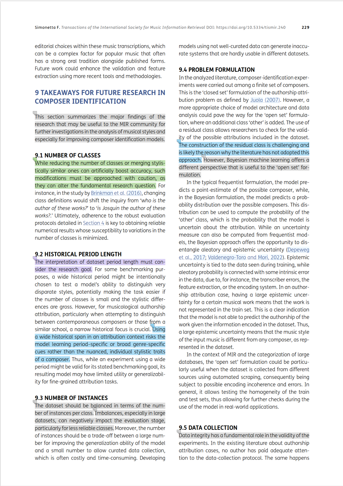

# Zotero Skimming

> [!WARNING]
> Use the add-on for a fast first pass only. Automated sentence selection can miss important sentences or introduce bias. Do not use the add-on for a detailed study of a paper.

Zotero Skimming selects important sentences in a PDF and saves them as native Zotero highlights. It does not change the PDF.

Skimming is a fast first pass over a paper. It is also called orientation reading.

Highlights stay temporary until you save them. Generate a preview, adjust the threshold, then save the sentences that you want in your library. The reader panel does not open dialogs.



## Requirements

- Zotero 9 or 10.
- Optional: Ollama. Ollama runs the local summary and embedding models.
- Optional: an OpenAI-compatible API endpoint and API key. The add-on uses the endpoint for remote summaries and embeddings.

If local summarization fails, the add-on falls back to a built-in TF-IDF (word frequency) ranker. `Remote API` needs a working endpoint and API key.

## Installation

1. Download the latest `.xpi` file from the [GitHub releases](https://github.com/00sapo/zotero-skimming/releases).
2. Open `Tools → Add-ons` in Zotero.
3. Open the gear menu and choose `Install Add-on From File…`.
4. Select the `.xpi` file. Restart Zotero if Zotero asks.
5. Open `Settings → Zotero Skimming` and choose a summary source.
6. Optional: install Ollama from https://ollama.com/download.

Ollama runs the models on your computer. If your computer cannot run the models, use a remote API. For Google or Anthropic, use a local LiteLLM gateway. LiteLLM provides an OpenAI-compatible API.

## Usage

1. Open the PDF in the Zotero reader.
2. Open the `Paper skim` section in the right pane.
3. Click `Generate highlights`. The status line shows extraction, ranking, and model progress.
4. Move the `Highlight threshold` slider to filter eligible sentences by normalized importance. Zero shows all eligible sentences. 100 hides all eligible sentences. The preview updates without another model run.
5. Click `Save as Zotero annotations…` to keep the visible highlights in your library. Click `Clear` to remove the preview.

All other settings live in `Settings → Zotero Skimming`:

- The summary source. Choose `Local Ollama` or `Remote API`.
- The compression ratio controls how many diverse candidates receive priority.
- The highlight threshold. Zero shows all eligible sentences. 100 hides all eligible sentences. The default is 75%.
- `Semantic relevance`. The add-on then ranks sentences by meaning.
- `Classify highlights from labeled summary` and the TOML label definitions.
- The endpoint, API key, and model names for remote use.
- The Ollama command, map-reduce, and the number of sentences per chunk.

The `Test Ollama` button reports its result on the settings page. In remote mode the button checks the endpoint and key fields and does not send a paper.

## How it works

### Summary

The add-on uses a local, model-free ranker by default. It does not start Ollama or send text to a remote service for this step.

When you enable `Semantic relevance` or labeled highlights, the add-on uses the selected summary source. The add-on also uses a remote source when you select `Remote API`.

### Map-reduce

Map-reduce (split, summarize, then combine) is optional. The add-on splits long text into chunks and summarizes each chunk. It then summarizes the partial summaries. Local chunks contain N sentences. Remote map-reduce uses a 4096-token context window. The settings pane shows the control in local mode. The setting also applies to remote summaries. Use map-reduce for long papers or small models.

### Extraction

The add-on reads the character geometry that the Zotero reader already has. It groups characters into visual lines, detects repeated column gutters, and removes running headers and footers. It finds the reference zone from citation signals. The sentence segmenter then divides the text, so each highlight rectangle matches the printed text.

### Ranking and highlights

The ranker scores all eligible sentences from 0 to 1. It gives priority to diverse candidates from its shortlist. The threshold then hides sentences below its value.

`Semantic relevance` uses embeddings, which are number lists that represent meaning. This option needs a summary and model inference. Labeled highlights also need a summary. With `Local Ollama` selected and both options off, the add-on selects highlights without models.

The add-on paints the selected sentences as temporary overlays. Nothing is written to the library until you click `Save as Zotero annotations…`. A second save skips sentences that already have an annotation, so repeated clicks do not create duplicates. Each saved highlight receives the `autoskim-key-sentence` tag.

With `Classify highlights from labeled summary`, the add-on compares each selected sentence with the summary labels or the label descriptions in the TOML box. It assigns the closest label and the label color.

`scoring-config.json` contains the score weights. `model-identifiers.json` contains the default model names.

## Models

| Stage | Default model |
|---|---|
| Summarization | `hf.co/unsloth/Qwen3.5-2B-GGUF:Q8_0` |
| Semantic relevance | `hf.co/PeterAM4/Qwen3-Embedding-0.6B-GGUF:Q8_0` |

`Test Ollama` pulls these models through the Ollama API. Ollama downloads the files from Hugging Face. Enter another model name in `Summary model` or `Embedding model` to use a different model.

## Similar plugins

SkimRead ([repository](https://github.com/adellife/zotero-skimread)) provides document-wide skimming for Zotero PDFs. A model selects the sentences. This add-on now follows its settings-pane, temporary-highlight, and explicit-save workflow.

Nodus ([repository](https://github.com/Drakonis96/nodus)) is a research workspace for Zotero. It includes search, cited answers, and sentence highlighting.

## Build and test

Requirements: Bash, Node.js, Yarn, `zip`, and `git`.

```sh
yarn install
./scripts/release.sh --only-build
yarn test
node --check bootstrap.js
node --check content/annotator.js
node --check content/extractor.js
node --check content/nlp.js
node --check content/model-manager.js
node --check content/remote-llm.js
git diff --check
```

`./scripts/release.sh --only-build` builds `zotero-skimming.xpi` in the repository root. It reads the version from `manifest.json` and includes the JSON configuration files, the icon asset, and the locale files.

Without `--only-build`, the script updates the version, updates `updates.json`, commits, tags, and can create a GitHub release.

Run the end-to-end smoke test against a real Zotero 10 installation and Ollama:

```sh
SMOKE_PDF="/path/to/paper.pdf" \
SMOKE_OLLAMA_COMMAND="mise exec -- ollama" \
yarn smoke
```

The smoke test runs the working tree in Zotero with a temporary profile. It checks summaries, embeddings, and highlights. It needs Ollama with the two models. See `AGENTS.md` for the options.

The [PDF extraction corpus](test/fixtures/pdf-extraction/README.md) contains downloaded templates, 16 controlled layout variants, and independent expected text. The test suite tracks extraction quality against a recorded baseline.

For a separate quality report, use Node.js from the repository root.

```sh
node scripts/evaluate-extraction.mjs --baseline test/fixtures/pdf-extraction/baseline.json
```


## References

- K. Rayner, E. R. Schotter, M. E. J. Masson, M. C. Potter, and R. Treiman, “So Much to Read, So Little Time,” Psychol Sci Public Interest, vol. 17, no. 1, pp. 4–34, Jan. 2016, doi: [10.1177/1529100615623267](https://doi.org/10.1177/1529100615623267).
- R. Fok et al., “Scim: Intelligent Skimming Support for Scientific Papers,” Proceedings of the 28th International Conference on Intelligent User Interfaces. ACM, pp. 476–490, Mar. 27, 2023. doi: [10.1145/3581641.3584034](https://doi.org/10.1145/3581641.3584034).
- G. B. Duggan and S. J. Payne, “Text skimming: The process and effectiveness of foraging through text under time pressure.,” Journal of Experimental Psychology: Applied, vol. 15, no. 3, pp. 228–242, 2009, doi: [10.1037/a0016995](https://doi.org/10.1037/a0016995).

## Repository

https://github.com/00sapo/zotero-skimming
