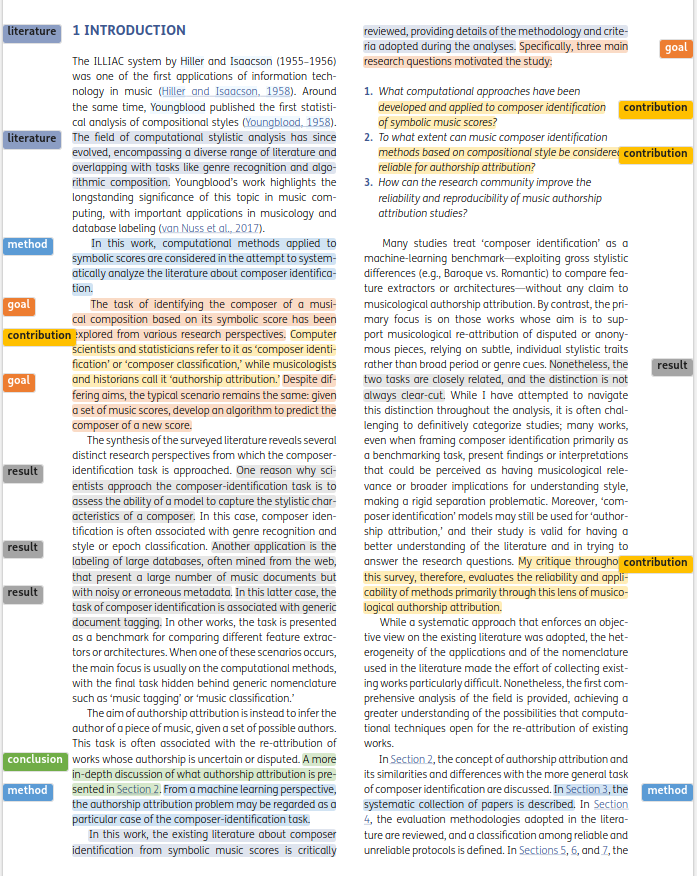

# Zotero Skimming

> [!WARNING]
> Use this add-on for a fast first pass over a paper only. Skimming is a quick read that finds the main ideas. Automated selection can miss important sentences or favor some topics. Do not use this add-on for a detailed study of a paper.



## Features

- 🧩 Works inside Zotero 9 and Zotero 10. The add-on is one package.
- 💻 Works on an offline consumer computer. The base ranker needs no downloads and no network.
- 🏠 Uses two default models in local mode. The models need about 4 GB of disk space.
- 🧠 Uses character geometry. The extractor follows columns and removes repeated headers, page numbers, and references.
- 📐 Handles two-column papers and multi-page documents. The extractor keeps reading order and sentence positions.
- 🎯 Ranks sentences with a score from 0 to 1. The score weights are in `scoring-config.json`.
- 🧭 Aligns the highlights with the paper summary. The selected sentences explain the summary in the same order.
- 🏷️ Adds a category to the selected highlights. A colored label on the nearest page edge shows the category at a glance.
- 👁️ Shows temporary highlights before any write. The PDF and the library stay unchanged until you save.
- 💾 Saves highlights to your Zotero library. Each saved item keeps a correct text position.
- 🔁 Skips duplicate saves. A second save adds only new sentences.
- ⚡ Updates the temporary highlights without a new analysis. The filter acts on stored scores.
- 🔒 Keeps text on the computer by default. Remote mode is optional and explicit.

The text layer is the selectable text inside the PDF. The add-on reads this text and scores the sentences. A highlight is a colored mark over text. A preview is a set of temporary highlights. The Zotero library holds your references and files. You review the preview and save useful sentences to your Zotero library.

## Installation

### Requirements

A model is a trained program that processes text. An endpoint is a web address that accepts requests.

- Zotero 9 or Zotero 10.
- Ollama for local summaries and local meaning comparisons.
- About 4 GB of free disk space for the two default models in local mode.
- An OpenAI-compatible endpoint, an API key, and a model name for remote mode.
- Bash, Node.js, Yarn, `zip`, and `git` only to build from source.

The add-on works without Ollama. In local mode, the base ranker then scores the sentences, and the status line reports the missing summary.

### Install the add-on

1. Download the latest `.xpi` file from the [releases page](https://github.com/00sapo/zotero-skimming/releases). The `.xpi` file is the add-on package.
2. Open `Tools → Add-ons` in Zotero.
3. Open the gear menu.
4. Choose `Install Add-on From File…`.
5. Select the `.xpi` file.
6. If Zotero asks for a restart, restart Zotero.
7. Open `Settings → Zotero Skimming`.
8. Choose `Local Ollama` or `Remote API`.

### Set up local models

1. Install Ollama from [ollama.com/download](https://ollama.com/download).
2. Open `Settings → Zotero Skimming`.
3. Enter the full path of the Ollama command, for example `/usr/bin/ollama`.
4. Press `Test Ollama`.

The button starts Ollama and downloads the two models when needed. It reports progress and errors on the same page. The first model download needs an internet connection and about 4 GB of free disk space.

### Set up remote mode

1. Choose `Remote API` as the summary source.
2. Enter the endpoint, the API key, and the model names.
3. Press `Test Ollama`. The button makes sure that the fields are valid and sends no paper.

Remote mode sends paper text to the endpoint. If a provider does not offer an OpenAI-compatible endpoint, use a gateway such as LiteLLM.

### Build from source

This method is for code changes only. You need Bash, Node.js, Yarn, `zip`, and `git`.

```sh
git clone https://github.com/00sapo/zotero-skimming.git
cd zotero-skimming
yarn install
./scripts/release.sh --only-build
yarn test
```

The build command writes `zotero-skimming.xpi` to the repository root. Install the file with the steps above.

## Usage

A Zotero annotation is a saved highlight in the library. A tag is a category name. A candidate is a sentence that the add-on can select. The threshold is the lowest score that a candidate needs. An embedding is a list of numbers that represents meaning.

1. Open the PDF in the Zotero reader.
2. Open the `Paper skim` section in the right pane.
3. Select the optional steps in the `Steps` box.
4. Press `Generate highlights`.
5. Watch the status line and the progress bar.
6. Move the `Highlight threshold` slider to filter the preview.
7. Press `Save as Zotero annotations…` to keep the visible highlights.
8. Press `Clear` to remove the preview.

`Semantic embeddings` compares sentence meaning with the summary. `Tagging` assigns a category to the selected highlights. The paper summary is always part of the pass. Changes to the steps apply when you press `Generate highlights` again. The `Paper summary` box shows the generated summary.

The threshold range is 0 to 100. Zero shows all candidates. One hundred hides all candidates. The default value is 75. A threshold change updates the preview without another analysis.

The add-on keeps the extracted text and the paper summary in memory for the session. Press `Generate highlights` again on the same PDF to reuse both. The compression ratio sets the number of selected sentences. A value of 10 selects one sentence for every ten candidates. A changed source, model, label configuration, long-paper split setting, or compression ratio starts a new summary.

Tagged highlights show a small colored label on the nearer page edge. Each label sits at the height of its highlight and shows the tag name. The label color comes from the tag definition.

A second save skips sentences that already have an annotation. Press `Remove saved annotations` twice to delete the annotations that the add-on created.

The settings page holds the other controls. It holds the summary source, the compression ratio, the default threshold, and the TOML tag definitions. It also holds the endpoint, the model fields, the Ollama command, and the long-paper split settings. The reader pane holds no settings forms and opens no dialogs.

## How it works

The add-on uses the text layer of the PDF. The source file stays unchanged.

### Text extraction

The Zotero reader exposes the position of each character. The extractor groups characters into lines and columns. It reads the columns in order and keeps paragraph boundaries.

Page furniture is content outside the body text. The extractor removes page furniture. Running headers, page numbers, footnotes, captions, table cells, and reference entries are page furniture. It also removes titles, authors, headings, and abstract text.

The add-on divides each block into sentences. Each sentence keeps the position of its printed text. A scanned PDF needs an OCR text layer. OCR turns a picture of text into text. The add-on does not perform OCR.

A PDF extraction corpus in the repository measures this behavior. It contains downloaded templates, 16 layout variants, and independent expected text. The test suite tracks the score against a recorded baseline.

### Paper summary

Every pass starts with a paper summary. The summary guides the ranking and the tagging. `Local Ollama` operates a small model on your computer. `Remote API` sends the text to the configured endpoint. If local summarization fails, the add-on reports the failure and uses the TF-IDF ranker. TF-IDF is a word-frequency score.

Map-reduce splits long text, summarizes the parts, and combines the results. A token is a small text unit for a model. Local parts hold the number of sentences from the settings page. Remote parts use a 4096-token window. Use map-reduce for long papers or small models.

### Sentence ranking

Every candidate receives an initial score from 0 to 1. The score combines summary similarity and sentence length. TF-IDF compares words. Embeddings compare meaning.

The selection step follows the summary order when the summary has more than one sentence. MMR is the fallback. MMR is a diversity rule that avoids repeated content. The selection step also spreads highlights across the paper and penalizes repeated sections. Selected sentences receive a score of 1. Other candidates receive at most 0.5.

The threshold hides sentences below its value.

`Semantic embeddings` needs a model. With this step off, the TF-IDF baseline ranks the sentences. The baseline needs no model and no network.

### Tagging

Tagging needs the summary and a local or remote model. The model labels up to 30 selected highlights in one batch. The prompt is the text that the model receives. The prompt includes the category definitions and labeled summary sentences as examples. The embedding classifier tags the candidates and serves as a fallback.

Each tag has a color from the configuration file. The preview paints the tag name on the nearer page edge. Saved annotations keep the tag as a native Zotero tag.

### Saving annotations

The add-on paints temporary highlights over the page. It writes nothing to the library until you press `Save as Zotero annotations…`. Each saved item is a native Zotero highlight annotation.

The add-on uses `Zotero.Annotations.saveFromJSON()` and keeps a valid position for each highlight. It adds the `autoskim-key-sentence` tag. It also adds the category tag when tagging is on. A second save skips text that already has an annotation.

### Models

| Stage | Default model |
|---|---|
| Summarization | `hf.co/unsloth/Qwen3.5-2B-GGUF:Q8_0` |
| Semantic relevance | `hf.co/PeterAM4/Qwen3-Embedding-0.6B-GGUF:Q8_0` |

`Test Ollama` downloads these models through the Ollama API. Ollama downloads the files from Hugging Face. Set another model name on the settings page to use a different model.

### Quality tests

Start the unit tests with `yarn test`. Start the end-to-end test against Zotero and Ollama with `yarn smoke`. Before you start the smoke test, set `SMOKE_PDF` to a PDF path. If Ollama is not at `/usr/bin/ollama`, set `SMOKE_OLLAMA_COMMAND`. The smoke test uses a temporary profile and does not touch your library.

## Credits

Zotero Skimming is maintained by [00sapo](https://github.com/00sapo). The license is the GNU GPL v3. See [LICENSE](LICENSE).

The add-on uses these projects and services:

- [Zotero](https://www.zotero.org/) provides the reader, the annotation API, and the item library.
- [PDF.js](https://mozilla.github.io/pdf.js/) provides the page text geometry inside the Zotero reader.
- [Ollama](https://ollama.com/) operates the local models.
- [Hugging Face](https://huggingface.co/) hosts the model files.
- The Qwen model family provides the base summary and embedding models.
- [SkimRead](https://github.com/adellife/zotero-skimread) and [Nodus](https://github.com/Drakonis96/nodus) are related Zotero projects.

The design follows studies of skimming and reading behavior:

- K. Rayner, E. R. Schotter, M. E. J. Masson, M. C. Potter, and R. Treiman, "So Much to Read, So Little Time," *Psychol Sci Public Interest*, vol. 17, no. 1, pp. 4-34, Jan. 2016, doi: [10.1177/1529100615623267](https://doi.org/10.1177/1529100615623267).
- R. Fok et al., "Scim: Intelligent Skimming Support for Scientific Papers," *Proceedings of the 28th International Conference on Intelligent User Interfaces*, ACM, pp. 476-490, Mar. 2023, doi: [10.1145/3581641.3584034](https://doi.org/10.1145/3581641.3584034).
- G. B. Duggan and S. J. Payne, "Text skimming: The process and effectiveness of foraging through text under time pressure," *Journal of Experimental Psychology: Applied*, vol. 15, no. 3, pp. 228-242, 2009, doi: [10.1037/a0016995](https://doi.org/10.1037/a0016995).

This README follows Simplified Technical English. No tool guarantees ASD-STE100 compliance. The official dictionary is free at [asd-ste100.org](https://asd-ste100.org/).

The source code is at [github.com/00sapo/zotero-skimming](https://github.com/00sapo/zotero-skimming).
